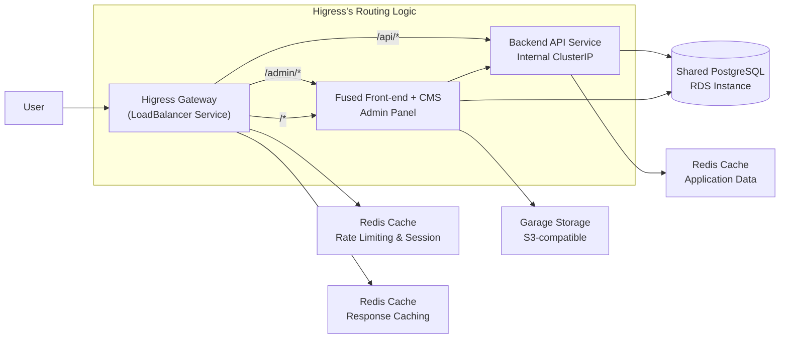
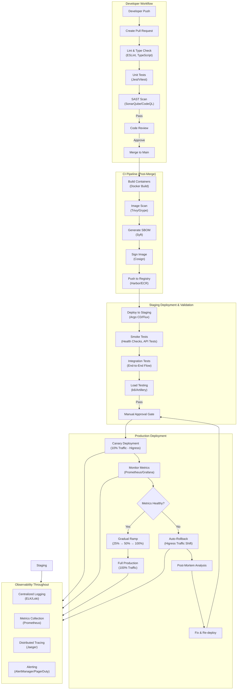

# Back-end system design

**Version**: `1.2`

**Date**: **2026-08-16**

**Status**: `Updated` — Monorepo restructure: fused Front-end + CMS (Next.js + Payload), React-free `cms-core` package replaces `shared-types`

**Version**: `1.1`

**Date**: **2026-08-07**

**Status**: `Updated` — CMS auth, DB schema separation, observability additions, deployment strategy

**Date**: **2026-07-28**

**Status**: `Initial`

---

# Executive Summary

This document defines the complete, production-ready architecture for **dacho innovation fun** application . The system is fully self-hosted, cloud-native, and designed for high availability, security, and maintainability. It comprises two deployable services — a fused Public Front-end + Payload CMS (Next.js) and a Back-end API — plus a shared, React-free `cms-core` package holding the CMS domain definition and generated types, all orchestrated on Kubernetes, with a feature-rich API gateway, distributed caching, object storage, and a full CI/CD pipeline with progressive deployment.

The architecture is battle-tested in large-scale production environments and is built entirely from open-source components, ensuring no vendor lock-in.

---

# High-Level Architecture Diagram

```
┌───────────────────────────────────────────────────────────────────────────────┐
│                              Internet                                        │
└──────────────────────────────────────────────────────────┬────────────────────┘
                                  │
                                  ▼
┌───────────────────────────────────────────────────────────────────────────────┐
│                         Higress API Gateway                                  │
│                                                                              │
│  ┌──────────────────────────────────────────────────────────┐                │
│  │  • TLS Termination (Let's Encrypt)                        │                │
│  │  • JWT Authentication & Authorization                     │                │
│  │  • Distributed Rate Limiting (Redis)                      │                │
│  │  • Response Caching (Redis)                               │                │
│  │  • Canary Routing (Weighted Traffic Split)                │                │
│  │  • Request Validation & Transformation                    │                │
│  └──────────────────────────────────────────────────────────┘                │
└──────────────────────────────────────────────────────────┬────────────────────┘
                                │
            ┌───────────────────┐
            │                   │
            ▼                   ▼
┌───────────────────────┐ ┌───────────────────┐
│   Front-end + CMS     │ │   Backend API     │
│   (Next.js + Payload) │ │   (Node.js)       │
│                       │ │                   │
│  • SSR/SSG            │ │  • Business Logic │
│  • Admin Panel        │ │  • Data Queries   │
│  • REST/GraphQL API   │ │  • Auth Logic     │
│  • Domain: myproj.ect │ │  • External APIs  │
│                       │ │  • Internal only  │
└───────────┬───────────┘ └─────────┬─────────┘
            │                       │
            └────────────┬──────────┘
                         │
                         ▼
              ┌───────────────────┐
              │  PostgreSQL       │
              │  (Shared)         │
              │                   │
              │  • CMS Content    │
              │  • User Data      │
              │  • Application    │
              └─────────┬─────────┘
                        │
                        ▼
┌─────────────────────────────────────────────────────────────────────────────┐
│                         Infrastructure Layer                                │
│                                                                             │
│  ┌──────────────┐  ┌──────────────┐  ┌──────────────┐  ┌──────────────┐    │
│  │  Kubernetes  │  │    Redis     │  │   Garage     │  │  Terraform   │    │
│  │   Cluster    │  │   (Cache)    │  │  (Storage)   │  │    (IaC)     │    │
│  │              │  │              │  │              │  │              │    │
│  │ Orchestrates │  │ • Rate Lim.  │  │ • Media      │  │ • VPC/Net    │    │
│  │ containers   │  │ • Sessions   │  │ • Uploads    │  │ • EKS/AKS    │    │
│  │ auto-scales  │  │ • Response   │  │ • Assets     │  │ • RDS        │    │
│  └──────────────┘  └──────────────┘  └──────────────┘  └──────────────┘    │
└─────────────────────────────────────────────────────────────────────────────┘
```

---

# Traffic Flow Diagram



---

# Component Breakdown

## Services

| Service | Technology | Domain | Responsibilities |
| -- | -- | -- | -- |
| Front-end + CMS (fused) | Next.js + Payload | myproj.ect (+ /admin) | Public site (SSR/SSG, client-side interactions), admin panel, and content API (REST/GraphQL). Imports the `@dacho/cms-core` config to serve admin + API routes. |
| Back-end API | Node.js | Internal ClusterIP only | Business logic, data querying, authentication logic, integration with external APIs. Uses shared PostgreSQL; consumes types from `@dacho/cms-core`. |
| cms-core (package) | Payload config + types | — (library) | React-free CMS domain definition: collections, globals, fields, hooks, access control, and generated `payload-types.ts`. No Next.js, no React. |

## Shared Infrastructure

| Component | Technology | Purpose |
| -- | -- | -- |
| API Gateway | Higress (Envoy-based) | Single entry point: TLS termination, JWT authentication, distributed rate limiting (via Redis), response caching, canary routing (weighted traffic), request validation, and access logging. |
| Database | PostgreSQL (Managed RDS or self-hosted) | Shared data store for CMS and Backend. Includes automated backups, read replicas, and encryption at rest. |
| Cache | Redis (3-node cluster) | Distributed cache for rate-limiting data, session storage, and response caching at the gateway layer. Uses schema separation: `cms.*` for Payload CMS tables, `public.*` for Backend API tables. Migrations are fully isolated; Backend accesses CMS data exclusively via Payload's REST API (API-key auth) — never the Local API. |
| Object Storage | Garage (S3-compatible, distributed) | S3-compatible storage for all file uploads, media assets, and static files managed by Payload CMS. Data is sharded and replicated across three nodes for durability. |
| Orchestration | Kubernetes (EKS/AKS/GKE or self-managed) | Container orchestration: auto-scaling, self-healing, service discovery, rolling updates, and canary deployments. |
| Infrastructure as Code | Terraform | Provisions cloud resources: VPC, subnets, Kubernetes cluster, RDS instance, security groups, and IAM roles. Uses remote state and separate workspaces for staging/production. |

## Monorepo & Type Sharing

All service codebases are managed in a single monorepo using pnpm workspaces and Turborepo. A dedicated React-free package, `@dacho/cms-core`, holds the entire CMS domain definition — Payload config, collections, globals, fields, hooks, and access control — plus the generated `payload-types.ts` (`payload generate:types`). It has no Next.js and no React dependency. The fused Front-end app imports this config to serve the admin panel and the REST/GraphQL API, and runs `payload generate:importmap` against it so its own custom admin components stay in the frontend. The Backend and Frontend both consume types from `@dacho/cms-core`, ensuring full TypeScript type safety across all layers without manual duplication.

---

# Security Architecture

| Layer | Security Measure | Implementation |
| -- | -- | -- |
| Network | VPC Isolation | Private subnets for all services |
| Gateway | TLS 1.3 | cert-manager with Let's Encrypt |
| Gateway | JWT Auth | Higress JWT plugin (validates, forwards user context as headers) |
| CMS Auth | Custom | Payload verifies backend-issued ES256 JWTs via the `backend-jwt` custom strategy (JWKS); editors use Payload's built-in HS256 auth |
| Gateway | Rate Limiting | Distributed via Redis |
| Gateway | WAF Protection | Higress WAF plugin |
| Application | Input Validation | Schema validation, sanitization |
| Application | CORS | Stricter CORS configuration |
| Application | Secrets | Kubernetes Secrets, HashiCorp Vault |
| Database | Encryption | TLS for connections, encryption at rest |
| Storage | Encryption | Server-side encryption on Garage |
| Image Scanning | Trivy/Snyk | In CI |
| Image Signing | Cosign | For provenance |
| Monitoring | Audit Logs | Centralized logging |
| Application | Error Tracking | GlitchTip Self-hosted error tracking with breadcrumbs and release tracking |

---

# CI/CD Pipeline Flow



---

# Detailed CI/CD Stage Breakdown

## Stage 1: Pre-Merge (Pull Request)

| Step | Tool | Purpose | Fail Condition |
| -- | -- | -- | -- |
| Lint | ESLint | Checks code style, catches errors | Any error |
| Type Check | TypeScript | Ensures type safety across all apps | Type errors |
| Unit Tests | Jest/Vitest | Tests individual functions and components | Any test failure |
| SAST Scan | SonarQube/CodeQL | Scans for security vulnerabilities | Critical/high findings |
| Dependency Check | Dependabot/Snyk | Checks for vulnerable dependencies | Critical/high CVEs |
| Build Check | Docker | Verifies container builds | Build failure |
| Code Review | Human | Quality and design validation | Approval required |

## Stage 2: CI Pipeline (Post-Merge)

| Step | Tool | Purpose | Fail Condition |
| -- | -- | -- | -- |
| Build | Docker Build | Builds containers for all 3 apps | Build failure |
| Image Scan | Trivy | Scans for CVEs in OS packages and dependencies | Critical/high vulnerabilities |
| SBOM | Syft | Generates software bill of materials (CycloneDX/SPDX) | *  |
| Image Signing | Cosign | Signs image for provenance (keyless) | Signing failure |
| Push | Docker Push | Pushes images to container registry | Push failure |
| Version Tagging | Git | Tags commit with version and image digest | *  |

## Stage 3: Staging Deployment & Validation

| Step | Tool | Purpose | Fail Condition |
| -- | -- | -- | -- |
| Deploy to Staging | Argo CD/Flux | GitOps sync to staging cluster | Deployment failure |
| Health Checks | Curl/kubectl | Verifies liveness and readiness probes | Pod not ready |
| Smoke Tests | Playwright/HTTPie | Tests critical endpoints (health, API, admin) | Endpoint returns 5xx |
| Integration Tests | Playwright/Cypress | Tests end-to-end user flows | Test failures |
| Load Testing | k6/Artillery | Validates performance under expected traffic | 95% latency increase |
| Security Scan | OWASP ZAP | Dynamic security scan | Critical findings |
| Manual Approval | GitHub Environments | Human approval before production | Approval not granted |

## Stage 4: Production Deployment (Canary)

| Step | Tool | Configuration |
| -- | -- | -- |
| Deploy Canary | Argo Rollouts | Creates new replica set with 10% traffic |
| Traffic Split | Higress | Routes 10% traffic to canary version (weighted routing) |
| Monitor | Prometheus + Grafana | Tracks error rates, latency, resource usage |
| Analyze | Prometheus + AlertManager | Compares metrics to baseline against thresholds |
| Step 1 Ramp | Argo Rollouts | Increase to 25% traffic after 5 minutes, if healthy |
| Step 2 Ramp | Argo Rollouts | Increase to 50% traffic after 5 minutes, if healthy |
| Step 3 Ramp | Argo Rollouts | Increase to 100% traffic after 5 minutes, if healthy |
| Auto-Rollback | Argo Rollouts | Switches to previous version on failure (error rate >5% or latency >50% spike) |
| Post-Mortem | Human | Root cause analysis after rollback |

---

# Observability Stack

| Component | Tool | Purpose |
| -- | -- | -- |
| Metrics | Prometheus | Collect metrics from services, nodes, and Kubernetes |
| Dashboards | Grafana | Visualization, custom panels |
| Alerting | AlertManager | Alerting on anomalies |
| Logs | Loki/ELK | Centralized log aggregation |
| Log Collection | Promtail/Filebeat | Log collection from pods |
| Traces | Jaeger | Distributed tracing |
| DB Telemetry | postgres_exporter | Prometheus scrapes Postgres metrics (slow queries, cache, connections) |
| Session Replay | OpenReplay | Self-hosted frontend session diagnostics (aspirational) |
| Synthetic | Grafana Synthetic | User journey monitoring |

---

# Repository Structure

```
my-project/
├── apps/
│   ├── backend/                  # Backend API (Node.js)
│   │   ├── src/
│   │   │   ├── routes/
│   │   │   ├── controllers/
│   │   │   ├── services/
│   │   │   └── types/            # Imports from @dacho/cms-core
│   │   ├── Dockerfile
│   │   ├── package.json
│   │   └── tsconfig.json
│   │
│   └── frontend/                 # Fused Front-end + CMS (Next.js + Payload)
│       ├── src/
│       │   ├── app/
│       │   │   ├── (payload)/    # Admin panel + REST/GraphQL API routes
│       │   │   └── (frontend)/   # Public site (App Router)
│       │   ├── components/       # Custom admin components + site UI
│       │   └── lib/
│       ├── Dockerfile
│       ├── package.json
│       └── tsconfig.json
│
├── packages/
│   └── cms-core/                 # React-free CMS domain definition
│       ├── package.json          # @dacho/cms-core
│       ├── src/
│       │   ├── payload.config.ts # Payload config (no UI, no server)
│       │   ├── collections/
│       │   ├── globals/
│       │   ├── fields/
│       │   ├── hooks/
│       │   ├── access/
│       │   └── payload-types.ts  # Generated by `payload generate:types`
│       └── index.ts              # Exports config + types
│
├── infrastructure/
│   ├── terraform/                # Infrastructure as Code
│   │   ├── main.tf
│   │   ├── variables.tf
│   │   ├── outputs.tf
│   │   ├── vpc.tf
│   │   ├── eks.tf
│   │   └── rds.tf
│   │
│   └── kubernetes/               # Kubernetes Manifests
│       ├── higress/
│       │   ├── helm-values.yaml
│       │   └── gateway.yaml      # Gateway API resources
│       ├── redis/
│       │   ├── statefulset.yaml
│       │   └── service.yaml
│       ├── garage/
│       │   ├── statefulset.yaml
│       │   └── service.yaml
│       └── services/
│           ├── backend-deployment.yaml
│           └── frontend-deployment.yaml
│
├── .github/
│   └── workflows/
│       └── ci-cd.yaml           # Full CI/CD pipeline
│
├── scripts/
│   ├── type-sync.sh             # payload generate:types -> cms-core
│   └── deploy.sh
│
├── tests/
│   ├── e2e/
│   ├── load/                    # k6 load tests
│   └── smoke/
│
├── pnpm-workspace.yaml
├── turbo.json                   # Monorepo task runner
├── package.json
├── docker-compose.dev.yaml
├── README.md
└── .env.example
```

---

# CI/CD Components Integration

| Component | CI/CD Role | Infrastructure Role |
| -- | -- | -- |
| GitHub/GitLab | Source code, PRs, CI triggers, approvals | *  |
| GitHub Actions/GitLab CI | Runs builds, scans, tests | *  |
| SonarQube/CodeQL | SAST scanning, code quality | *  |
| Trivy/Grype | Container image vulnerability scanning | *  |
| Syft | SBOM generation | *  |
| Cosign | Image signing (keyless) | *  |
| Container Registry | Stores signed images with SBOM | *  |
| Argo CD/Flux | GitOps sync to staging/production | Monitors Git repo for changes |
| Argo Rollouts | Canary deployment management | Updates Kubernetes manifests |
| Higress | Routes traffic for canary (weighted) | Single entry point, rate limiting |
| Prometheus | Collects metrics for rollback decisions | *  |
| AlertManager | Triggers rollback on anomalies | *  |
| k6/Artillery | Load testing | *  |
| Playwright/Cypress | E2E testing | *  |
| Terraform | Provisions staging/prod infrastructure | *  |

---

# Production Readiness Checklist

| Area | Status | Implementation |
| -- | -- | -- |
| Infrastructure | ✅ | Terraform + Kubernetes |
| API Gateway | ✅ | Higress (Envoy-based) |
| Cache | ✅ | Redis cluster |
| Storage | ✅ | Garage (S3-compatible) |
| Database | ✅ | PostgreSQL with replication |
| CI/CD | ✅ | GitHub Actions + Argo CD |
| Pre-Merge Checks | ✅ | Lint, TypeScript, Unit Tests, SAST, Dependency Check, Build |
| Image Scanning | ✅ | Trivy/Snyk on every build, fail on critical/high |
| SBOM + Signing | ✅ | Syft + Cosign |
| Staging Environment | ✅ | Production mirror |
| Smoke/Integration | ✅ | Playwright, end-to-end |
| Load Testing | ✅ | k6 |
| Canary Deployment | ✅ | Higress + Argo Roll-outs |
| Auto-Rollback | ✅ | On error rate/latency spike |
| Manual Approval | ✅ | Production environment gate |
| TLS/HTTPS | ✅ | cert-manager + Let's Encrypt |
| JWT Authentication | ✅ | Higress built-in |
| Rate Limiting | ✅ | Distributed via Redis |
| Metrics | ✅ | Prometheus + Grafana |
| Logs | ✅ | Loki/ELK |
| Traces | ✅ | Jaeger |
| Health Probes | ✅ | Liveness, Readiness, Startup |
| Graceful Shutdown | ✅ | SIGTERM handling |
| Backups | ✅ | Automated database snapshots |
| Documentation | ✅ | Architecture + operations |
| Admin User Seed | ✅ | Seed script from secrets on startup |
| Error Tracking | ✅ | GlitchTip (self-hosted) |
| DB Telemetry | ✅ | postgres_exporter → Prometheus |

---

# Summary Table

| Component | Technology | Purpose |
| -- | -- | -- |
| API Gateway | Higress | Single entry point, routing, rate limiting, TLS, caching |
| Cache | Redis (Cluster) | Distributed rate limiting, session cache, response cache |
| Object Storage | Garage | S3-compatible media storage |
| Database | PostgreSQL | Shared data store |
| Orchestration | Kubernetes | Container orchestration, auto-scaling |
| Infrastructure | Terraform | Provision VPC, cluster, RDS |
| Front-end + CMS | Next.js + Payload | Fused public site + admin panel + content API (myproj.ect) |
| Back-end | Node.js | Business logic, API endpoints |
| cms-core | Payload config + types | React-free shared package (`@dacho/cms-core`) |
| CI/CD | GitHub Actions + Argo CD | Automated pipelines |
| Deployment | Argo Roll-outs | Canary, blue-green |
| Metrics | Prometheus + Grafana | Monitoring, dashboards |
| Logs | Loki/ELK | Centralized logging |
| Traces | Jaeger | Distributed tracing |
| Security Scanning | Trivy/Snyk | Container vulnerability scanning |
| Email | SMTP (self-hosted) | Provider TBD. Transactional email for Contact Us form and notifications. |
| SBOM | Syft | Software bill of materials |
| Image Signing | Cosign | Provenance |
| Testing | Playwright/Cypress + k6 | E2E, integration, load testing |

---

## Deployment Strategy

**Phase 1 (current):** Docker Compose on a single VPS — sufficient for provincial scale (Bushehr Innovation Factory). Postgres, Redis, the fused Front-end + CMS, and the Backend API run on one machine behind Nginx/Caddy.

**Aspirational:** Full Kubernetes orchestration with Argo CD, canary deployments, Higress gateway, and the complete observability stack described in this document. The architecture here represents the target state for larger scale.

---

# Companies using the tech stack

This architecture is production-grade and battle-tested, combining:

* Sealos-proven Higress gateway handling 160,000+ users
* Alibaba-proven Envoy-based routing
* Enterprise-grade CI/CD with progressive deployment
* Complete observability for operational excellence
* Full self-hosting with no vendor lock-in

All components are open-source, self-hosted, and ready for production at scale.

---

## Authentication & Authorization

Detailed specifications live in dedicated documents:

- **[Authentication](https://linear.app/dacho/document/authentication-9ef52b3f5c63)** — identity model (central `users` collection, `companies` as orgs), OTP-first application auth, asymmetric JWT (ES256).
- **[Authorization](https://linear.app/dacho/document/authorization-3698cc7f4c72)** — roles as the RBAC permission unit, workflow-step gating.

Repo counterparts: `docs/linear/authentication.md`, `docs/linear/authorization.md`.