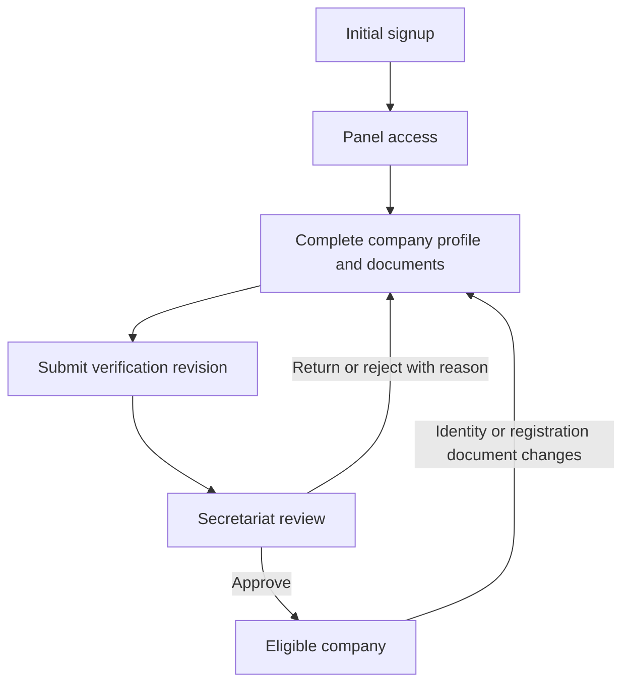
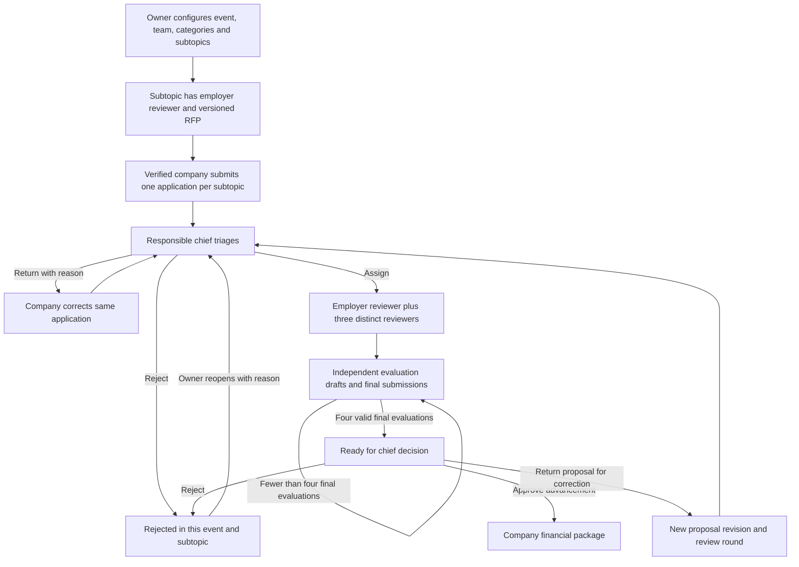
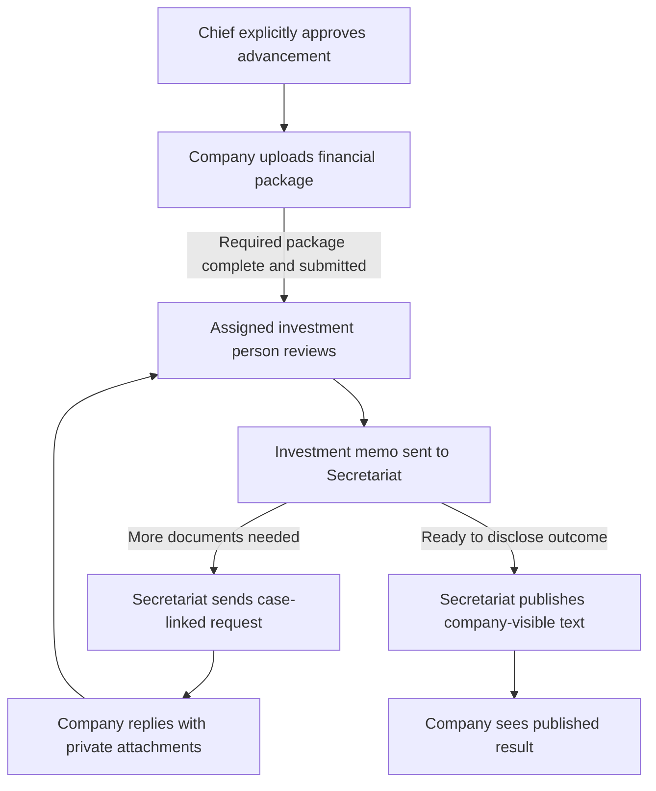
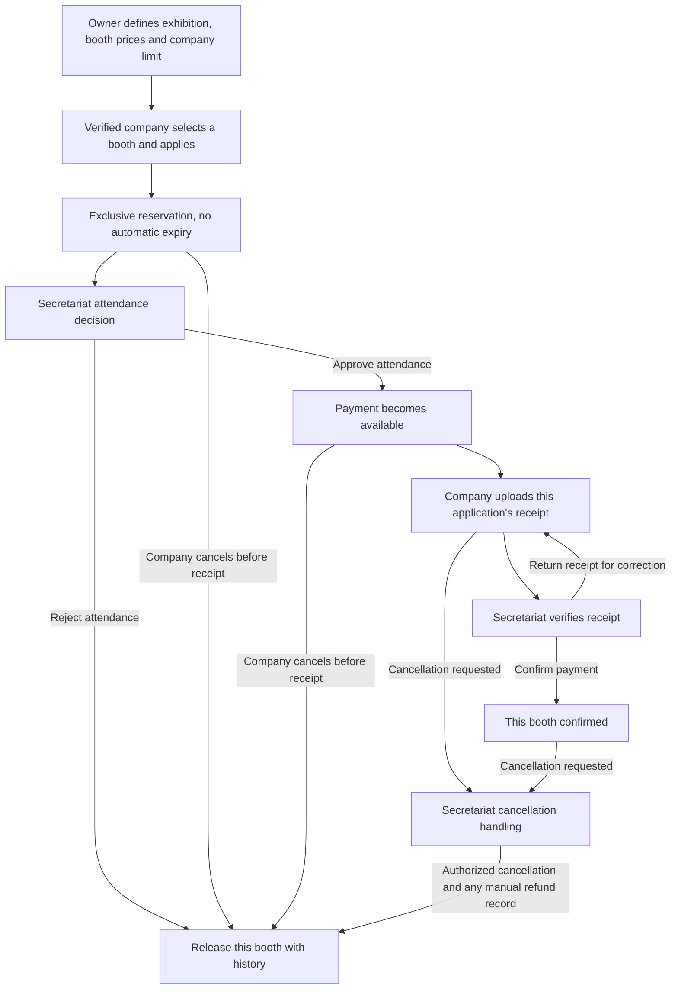

# Workflow specification

These are approved business transitions expressed as proposed implementation states. State identifiers are examples, not assertions about existing API enums. Keep verification, application, review-assignment, financial-document, booth-reservation and receipt states separate.

## 1. Company verification

| Transition | Actor | Preconditions | Persisted effects |
| --- | --- | --- | --- |
| Register | Public company representative | Unique company national ID; valid signup data | Person and company created atomically; panel session, no participation approval |
| Submit verification | Own representative | Required information/documents complete; explicit absence answers where permitted | Immutable submitted revision; Secretariat queue; notification/history |
| Approve | Secretariat | Submitted revision still current; authorized reviewer | Approved revision and decision actor/time/reason; eligibility becomes available |
| Return/reject documents | Secretariat | Pending submitted revision | Reason visible to company; same profile can be corrected and resubmitted |
| Edit approved identity | Own representative or authorized administrator | Valid authorized edit | Current verification becomes pending/incomplete as appropriate; previous application snapshots remain unchanged |

An unverified company may use its panel and complete its profile. It cannot create/submit a formal event application or reserve a booth. Local unsent form editing is not a formal application.

## 2. Event application and review

| Operation | Actor and guards | Required result |
| --- | --- | --- |
| Save application draft | Owning verified company, valid subtopic/event | Editable data tied to company; no review progress |
| Submit | Owning verified company, registration open, valid form/consent/proposal, no active duplicate/rejection lock | Tracking code, submitted revision and RFP/form/rules/company snapshots; chief queue |
| Triage return | Chief assigned to event | Reason and correction action; preserve tracking identity |
| Triage reject | Chief assigned to event | Terminal outcome and lock for company + event + subtopic; unrelated applications stay usable |
| Start review | Chief assigned to event | Exactly four active distinct people; one fixed employer slot and three ordinary slots; round references proposal revision |
| Save evaluation draft | Current assigned reviewer | Only own answers change; no contribution to completion count |
| Finalize evaluation | Current assigned reviewer, complete valid fixed rubric | Lock own submission; update completion exactly once; notify responsibly |
| Replace ordinary reviewer | Responsible chief, unfinished ordinary assignment | Old assignment access revoked; replacement begins new assignment; history remains |
| Replace employer | System Owner, explicit reason | Exceptional replacement captured against the case; historical RFP/employer context preserved |
| Complete round | Derived from final evaluations for active slots on current revision | Only 4/4 enables chief decision; no automated acceptance |
| Approve advancement | Responsible chief, current round complete | Financial package stage opens; company notified |
| Correct proposal after review begins | Company in an authorized correction state | New proposal revision and round; old scores retained but excluded from new 4/4 |
| Reopen terminal rejection | System Owner, reason | Same application/history reopened; never silently create a duplicate application |

Chief and employer assignments are captured for the relevant event/case. Changing a live subtopic RFP or personnel configuration must not retroactively rewrite an already submitted application. Technical handling of deactivated personnel must preserve history and remove active access.

## 3. Investment package, supplementary files and publication

Financial-stage files have an independent audience: owning company, assigned investment person, Secretariat and owner. Do not expose them through a chief/reviewer request detail, message preview, attachment URL, search result or populated record.

The investment person has a memo submission action, not separate approve/reject/return controls. Secretariat distinguishes an interim document request from publication. Supplementary files remain case-linked, versioned and accessible to the same authorized investment person. A memo may lead to another review cycle; it must not be automatically released to the company. Publication records publisher, time and the disclosed text, separately from internal notes.

## 4. Independent booth applications

Every selected booth follows this flow independently. Requesting several booths creates several applications and several independent receipt histories, not one aggregate payment.

| Action | Actor | Guard | Inventory/financial effect |
| --- | --- | --- | --- |
| Configure | Owner | Valid exhibition, identifiers, fixed prices and company limit | Sellable booth catalogue and guide map |
| Apply/reserve | Verified company | Booth available, event valid, active/confirmed company count below limit | Atomic reservation linked to one booth application |
| Approve attendance | Secretariat | Pending attendance request | Enable receipt submission for that application only |
| Reject attendance | Secretariat | Authorized pending request, reason | Release corresponding reservation with history |
| Upload receipt | Owning company | Attendance approved, policy-valid document | Pending verification; does not confirm booth |
| Return receipt | Secretariat | Receipt pending verification | Preserve reservation and prior receipt; allow corrected receipt |
| Confirm payment | Secretariat | Independently verified receipt for correct application/amount | Confirm booth exactly once; repeated action has no second effect |
| Cancel before receipt | Owning company | No receipt submitted | Release only this booth and update active count |
| Request later cancellation | Owning company | Receipt submitted or payment confirmed | Queue request; company does not directly release inventory |
| Process cancellation/refund | Secretariat | Explicit decision and evidence | Recorded manual financial handling and atomic inventory release; preserve ledger/history |
| Passage of time | No actor | Any active reservation | No automatic expiry or release |

## 5. Failure and consistency rules

- Repeated submit/confirm/finalize requests must not duplicate the operation, tracking code, count, notification or financial effect.
- Stale pages must refresh or report a conflict instead of overwriting another actor's decision.
- A failed file upload does not create a valid submission; a failed notification does not lose the committed transition.
- Changing one booth/subtopic application does not change another independent application.
- Download authorization is checked at use time, including after reviewer replacement, role removal or reassignment.
- Every consequential decision captures actor, timestamp, reason where applicable, current revision and source/target state.

## 6. Human acceptance checkpoints

See [manual acceptance tests](manual-acceptance-tests.md). Run the matching human test as soon as a coherent slice is available: login can be accepted before review exists; reviewer completion can be accepted before final exhibition delivery. Keep engineering completion and human verification separate. A full event or exhibition walkthrough remains required after individual gates pass.
